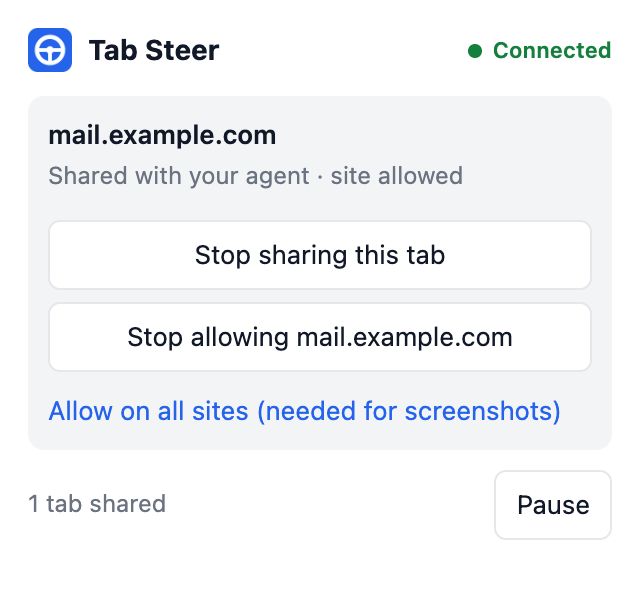
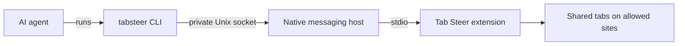

<div align="center">


# Tab Steer

**Hand your coding agent a tab, not your browser.**

[](https://github.com/faysalmehmood/tabsteer/actions/workflows/test.yml)
[](LICENSE)


[Website](https://tabsteer.conceptlix.com) · [Install](#install) · [Commands](#commands) · [Safety model](#safety-model) · [Threat model](docs/threat-model.md)

</div>

Tab Steer is a Chrome extension and a command-line tool. Together they let any AI agent that can run a shell command read and act on pages in your real, logged-in browser. The agent reaches only the tabs you share and the sites you allow.

```console
$ tabsteer open news.ycombinator.com
Opened tab 1853312301

$ tabsteer read
# Hacker News
[new](newest) @kq2 | [past](front) @kq3 | [comments](newcomments) @kq4 ...

$ tabsteer click @kq2
Clicked link "new" @kq2
```

> [!NOTE]
> Version 0.1 is an early release for macOS and Linux. It is not yet on the Chrome Web Store, so the extension is loaded unpacked.

## Why Tab Steer

| | |
| --- | --- |
| **Your real session** | Works in the browser where you are already signed in. No separate, logged-out automation browser. |
| **No context overhead** | It is a CLI, not a tool server. Nothing is added to the model's context until a command runs. |
| **Any agent** | Claude Code, Antigravity, Codex, Cursor, or a shell script. |
| **Limits first** | Starts with no access. You decide which tabs and which sites, and you can pause at any time. |
| **No dependencies** | The CLI and host use only the Node.js standard library. |

## Safety model



An agent in your logged-in browser acts as you, so every limit is held in the browser, where the agent cannot change it.

- **Shared tabs only.** The agent acts only on tabs in the "Tab Steer" tab group. Drag a tab in to share it, drag it out to stop.
- **Allowed sites only.** The extension installs with access to no sites. You grant each site from the toolbar icon.
- **One-click pause.** Every command is refused until you resume.
- **No network surface.** The CLI reaches the browser over a Unix socket only your user can open. Nothing listens on a port.
- **Secrets withheld.** Password, payment and one-time-code values are never returned.
- **No arbitrary code.** There is no `eval` command.
- **No telemetry.** Nothing is collected or sent anywhere. See the [privacy policy](docs/PRIVACY.md).

Read the [threat model](docs/threat-model.md) before using Tab Steer on accounts that matter. Web pages can contain text written to manipulate an agent, and Tab Steer cannot tell whose instructions the agent is following.

<br clear="right">

## Install

Requires Node.js 18 or newer and a Chromium-family browser (Chrome, Brave, Edge, Vivaldi, Arc, Chromium).

**1. Install the command-line tool**

```sh
npm install -g tabsteer
tabsteer install
```

Or from source:

```sh
git clone https://github.com/faysalmehmood/tabsteer.git
cd tabsteer
./install.sh
```

**2. Load the extension**

1. Open `chrome://extensions` and turn on **Developer mode**.
2. Click **Load unpacked** and select the `extension` folder. `tabsteer install` prints its full path.

**3. Check the setup**

```sh
tabsteer doctor
```

Every line should show a tick. To remove everything outside the browser, run `tabsteer uninstall`.

## Usage

**Share a tab.** Click the Tab Steer toolbar icon on a tab and choose **Share this tab with your agent**. The agent can also open its own tab with `tabsteer open <url>`. The first time a site is used, you allow it from the same icon.

**Teach your agent.** A ready-made skill ships in [`skills/tabsteer`](skills/tabsteer/SKILL.md).

| Agent | Setup |
| --- | --- |
| Claude Code | `tabsteer install --agent claude` |
| Antigravity | `tabsteer install --agent antigravity` |
| Others | Paste [`docs/agent-snippet.md`](docs/agent-snippet.md) into `AGENTS.md` or your rules file |

## Commands

| Command | Description |
| --- | --- |
| `tabsteer status` | Connection state, paused or not, number of shared tabs |
| `tabsteer tabs` | List shared tabs and their ids |
| `tabsteer open <url> [--background]` | Open a URL in a new shared tab |
| `tabsteer navigate <url>` | Load a URL in a shared tab |
| `tabsteer back` | Go back one page |
| `tabsteer close` | Close a shared tab |
| `tabsteer read [--offset N] [--limit N]` | Page as Markdown. Each control carries a ref such as `@kq12` |
| `tabsteer click <ref\|text\|css=sel>` | Click one element. Ambiguous text returns candidates and clicks nothing |
| `tabsteer type <text> [--into <ref>]` | Replace a field's content, or choose a `<select>` option |
| `tabsteer press <key> [--into <ref>]` | Enter, Tab, Escape, Space, arrow keys, or one character |
| `tabsteer scroll [up\|down\|top\|bottom] [px]` | Scroll the page |
| `tabsteer wait <text\|ref\|css=sel> [--gone] [--timeout ms]` | Wait for something to appear or disappear |
| `tabsteer snap [--out file.png]` | Screenshot the visible part of the tab |

Global options: `--tab <id>` selects a tab when several are shared, `--json` prints raw results.

## How it works



The browser launches the host, the CLI connects to it, and the extension decides what each command may touch. The reasoning behind this design is in [docs/decisions.md](docs/decisions.md).

## Known limits

- Clicks and key presses are simulated in the page. Sites that require trusted input events may ignore them.
- Cross-origin iframes and closed shadow roots are not readable.
- One browser profile at a time. The most recently started profile owns the connection.
- Windows is not supported yet.

## Responsible use

Some websites prohibit automated access in their terms and may restrict accounts that use it. You are responsible for the sites you point Tab Steer at. Prefer a site's official API where one exists. Tab Steer has no features for evading bot detection, and none will be added.

## Development

```sh
npm install
npm test                          # host and CLI
npx playwright install chromium
npm run test:e2e                  # real Chromium with the extension loaded
```

Security issues: please report them privately, as described in [SECURITY.md](SECURITY.md).

## Credits

The idea of a CLI-first controller for the user's real browser was shown publicly by [Ivan Leo](https://x.com/ivanleomk) ([GitHub](https://github.com/ivanleomk)), building on the approach of the OpenAI Codex Chrome extension. Tab Steer is an independent implementation, not affiliated with or endorsed by Google, OpenAI, Anthropic or anyone named here.

## License

[Apache-2.0](LICENSE)
