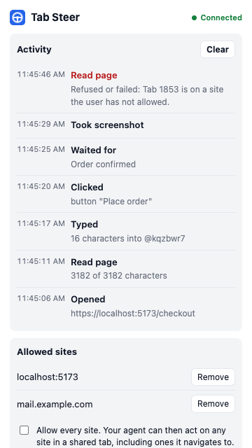

<div align="center">


# Tab Steer

**Hand your coding agent a tab, not your browser.**

[](https://chromewebstore.google.com/detail/tab-steer/mkpmilnglglhiaeojeeioafmbjjghmed)
[](https://www.npmjs.com/package/tabsteer)
[](https://github.com/faysalmehmood/tabsteer/actions/workflows/test.yml)
[](LICENSE)

[Website](https://tabsteer.conceptlix.com) · [Set up](#set-up) · [Use it](#use-it) · [Stay in control](#stay-in-control) · [Commands](#commands)

</div>

Tab Steer lets your coding agent (Claude Code, Antigravity, Codex, Cursor, or anything that can run a shell command) read and use pages in your real, logged-in Chrome. It works only in the tabs you share, on the sites you allow.

You talk to your agent as usual. The agent runs `tabsteer` commands to read the page and click or type. You watch it happen in the tab.

## Set up

You need Chrome (or another Chromium browser) and Node.js 18 or newer, on macOS or Linux.

1. **Add the extension** from the [Chrome Web Store](https://chromewebstore.google.com/detail/tab-steer/mkpmilnglglhiaeojeeioafmbjjghmed) and click **Turn on** on the welcome page.
2. **Install the companion** in a terminal:
   ```sh
   npm install -g tabsteer && tabsteer install
   ```
3. **Teach your agent.** For Claude Code run `tabsteer install --agent claude`, for Antigravity `--agent antigravity`. For other agents, paste [docs/agent-snippet.md](docs/agent-snippet.md) into `AGENTS.md` or your rules file.
4. **Share a tab.** On the page you want help with, click the Tab Steer icon and choose **Share this tab with your agent**.

`tabsteer doctor` checks the setup if something doesn't connect.

## Use it

Ask your agent in plain words. For example:

- *"Open localhost:5173, fill in the signup form with test data and tell me what breaks."*
- *"Read the error on the Sentry page I shared and find the cause in this repo."*
- *"In the shared admin tab, list the last 20 orders as a table."*
- *"Reproduce the bug from issue #42 in my shared tab and take a screenshot."*

Behind the scenes, the agent runs commands like these:

```console
$ tabsteer read
# Sign up
[input:email "Email" value="" @kqzbwr4] [button "Create account" @kqzbwr9]
$ tabsteer type "test@example.com" --into @kqzbwr4
$ tabsteer click @kqzbwr9
Clicked button "Create account" @kqzbwr9
```

The agent can also open new tabs itself (`tabsteer open`), on sites you have allowed. They join the shared group.

## Stay in control



- **Shared tabs only.** The agent works only in the "Tab Steer" tab group. Drag a tab out, or click **Stop sharing**, to take it back.
- **Allowed sites only.** Sharing a tab allows its site. You can remove sites at any time. The agent can't add any.
- **See everything.** The **Activity** panel shows every action as it happens, including refused ones. Typed text is never logged.
- **Pause.** One click stops every command until you resume.
- **Secrets stay hidden.** Values of password, payment and one-time-code fields are never returned to the agent.
- **Local only.** No network listener, no telemetry. See the [privacy policy](docs/PRIVACY.md).

An agent in your browser acts as you, and web pages can contain text written to mislead it. Read the [threat model](docs/threat-model.md) before using Tab Steer on accounts that matter.

<br clear="right">

## Commands

These are what your agent runs. You rarely need them yourself.

| Command | What it does |
| --- | --- |
| `tabsteer tabs` | List shared tabs |
| `tabsteer open <url>` / `navigate <url>` / `back` / `close` | Open, load, go back in, or close a shared tab |
| `tabsteer read` | The page as Markdown, with a ref such as `@kqzbwr4` on each control |
| `tabsteer click <ref\|text>` | Click one element. Ambiguous text returns the candidates instead of guessing |
| `tabsteer type <text> --into <ref>` | Fill a field or choose a `<select>` option |
| `tabsteer press <key>` | Enter, Tab, Escape, Space, arrows, or one character |
| `tabsteer scroll [up\|down\|top\|bottom]` | Scroll the page |
| `tabsteer wait <text\|ref>` | Wait for something to appear (`--gone` to disappear) |
| `tabsteer snap` | Screenshot the visible tab |
| `tabsteer status` / `doctor` | Connection state / full setup check |

Add `--tab <id>` when several tabs are shared, and `--json` for raw output. `tabsteer --help` lists every option. `tabsteer uninstall` removes everything outside the browser.

## Limits

- Clicks and key presses are simulated in the page, so a few sites ignore them. Password managers often cancel Enter on login forms; Tab Steer then reports it and names the submit button to click.
- Cross-origin iframes are not readable.
- With Tab Steer in several Chrome profiles, the agent controls the most recently opened one.
- Windows is not supported yet.
- Some sites prohibit automated access in their terms. You are responsible for where you use Tab Steer. It has no features for evading bot detection.

## How it works

The `tabsteer` command talks to a small companion program that Chrome starts, over a socket only your user can open. The companion passes each command to the extension, which checks the tab, the site and the pause switch before acting. Design notes are in [docs/decisions.md](docs/decisions.md).

## Contributing

Bug reports and pull requests are welcome. See [CONTRIBUTING.md](CONTRIBUTING.md) for building, testing and releasing, and [SECURITY.md](SECURITY.md) for reporting security issues privately.

## Credits and license

The idea of a CLI-first controller for the user's real browser was shown publicly by [Ivan Leo](https://x.com/ivanleomk) ([GitHub](https://github.com/ivanleomk)), building on the approach of the OpenAI Codex Chrome extension. Tab Steer is an independent implementation, not affiliated with or endorsed by Google, OpenAI, Anthropic or anyone named here.

Licensed under [Apache-2.0](LICENSE).
